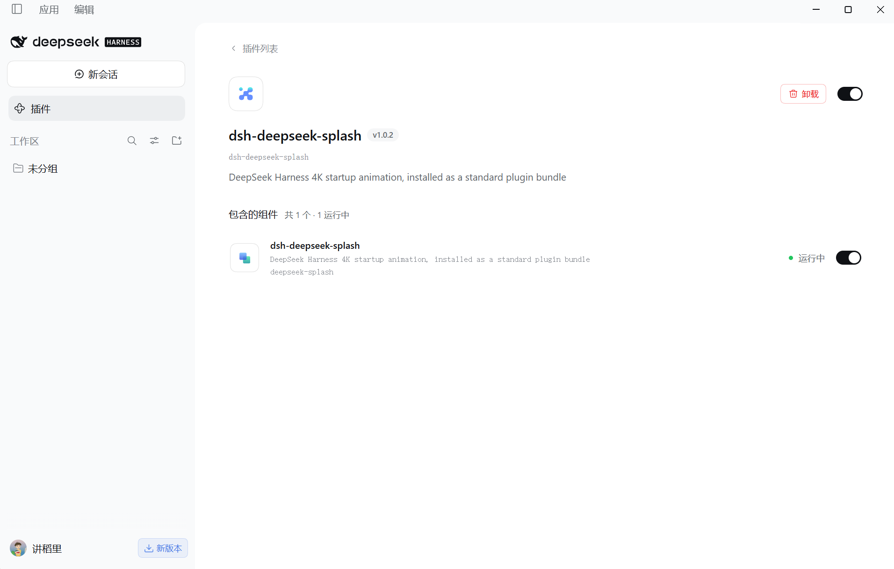

# DeepSeek Harness 4K 开屏动画

**当前版本：1.0.2** · 插件直装 · 4K 动画 · 无需修改客户端

为 DeepSeek Harness 添加 4 秒 4K 开屏动画。通过客户端插件界面安装，视频与海报随插件提供，无需克隆仓库、构建或运行安装脚本。


## 插件直装

1. 打开 DeepSeek Harness，进入左侧「插件」，打开插件安装入口。
2. 输入以下地址并安装：

   ```text
   github:PZEHONG/deepseek-splash
   ```

   如果安装界面要求 GitHub URL，使用：

   ```text
   https://github.com/PZEHONG/deepseek-splash
   ```

3. 安装完成后，确认 `dsh-deepseek-splash` 已启用，版本为 **v1.0.2**，包含的组件显示「运行中」。
4. 从系统托盘完全退出 DeepSeek Harness，再重新打开，即可看到开屏动画。

以下为 v1.0.2 插件已安装并运行的界面：



如果已经安装过旧版原生补丁，请先按[旧版补丁说明](docs/legacy-native-patch.md#还原)还原原版，再安装插件，避免重复播放开屏。

## 播放效果

- **4K 素材**：3840×2160、24 fps、VP9 静音视频，保留现有动画和海报。
- **完整播放**：默认播放完整 4 秒动画，应用同时在后台加载；视频结束后显示应用界面。
- **简洁开屏**：Windows 桌面版播放期间隐藏右上角最小化、最大化/还原和关闭按钮；动画结束或跳过后恢复。
- **随时跳过**：点击「跳过」或按 `Esc` 即可进入应用。播放失败、启动错误或系统偏好减少动态效果时直接显示界面，最多遮挡 15 秒。
- **保留窗口设置**：动画显示在应用窗口内，不强制全屏或更改窗口尺寸。

插件从宿主返回应用页面后开始显示，无法覆盖客户端进程启动到页面返回之前的阶段。动画结束时若应用仍未加载完成，会继续显示应用自身的加载界面。

[观看完整动画](package/harness-splash.webm)

## 禁用或卸载

在 DeepSeek Harness 的插件管理中关闭或卸载 `dsh-deepseek-splash`，完全退出并重新启动应用，即可恢复默认启动效果。

## 开发与验证

插件使用原生 JavaScript，无编译步骤、安装脚本或运行时额外依赖。

```sh
npm ci --ignore-scripts
npm test
npm pack --dry-run
```

Web profile 可使用命令行安装：

```sh
dsh plugin --profile web add github:PZEHONG/deepseek-splash
```

桌面版请使用客户端插件安装入口，以便安装到正确的 profile。

已通过本地 0.1.5-rc.2 的 Cordis/Connection 集成测试与 12 项自动测试，并在本机桌面版验证 4K 播放及窗口按钮隐藏、恢复。兼容性依赖宿主提供 `webserver/index-inject` 和 `connection.fetch.register` 接口。详见[验证记录](docs/plugin-validation.md)。

仓库仍保留[旧版原生补丁说明](docs/legacy-native-patch.md)，供旧版安装的用户查阅。

## 感谢与支持

感谢你使用 DeepSeek Harness 开屏动画！每一次 Star、反馈和分享，都是对这个项目的支持。

如果这个小插件让你的每次启动多了一份好心情，也欢迎自愿打赏，请我喝杯咖啡。感谢你的鼓励与支持！

| 微信打赏 | 支付宝打赏 |
| :---: | :---: |
|  |  |
