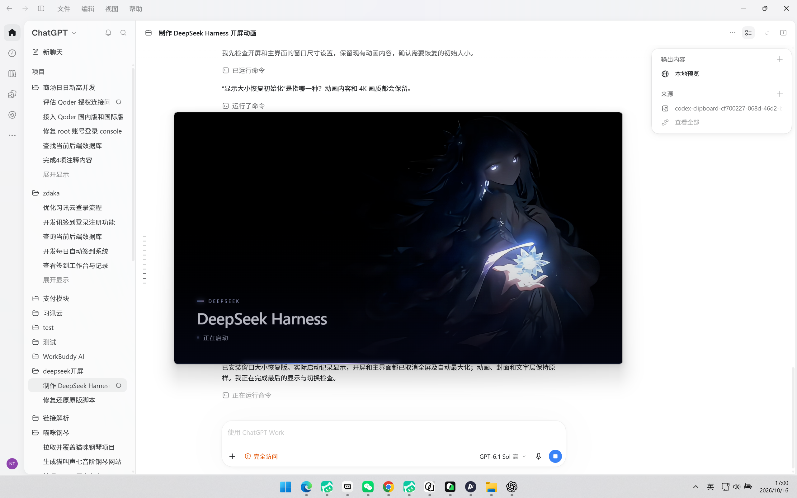
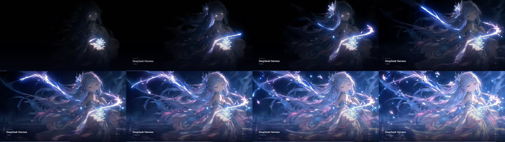

# DeepSeek Harness 开屏动画

为 DeepSeek Harness 桌面应用注入 4K 开屏动画：应用启动时以 960×540 居中窗口播放 4 秒 3840×2160 VP9 静音动画，主界面就绪后立即无缝交接，不额外等待。


## 特性

- **4K 品质**：直接由原始 4K 素材制作（3840×2160、24 fps、VP9、CRF 14），未缩放再放大，与原素材 SSIM 0.992156
- **秒级交接**：主界面完成首帧绘制立即停止动画并显示应用；内置加载页在隐藏窗口中同时进行
- **窗口化启动**：开屏约 960×540 居中，主界面恢复原始约 1280×820，最大化/还原/最小化/关闭按钮均可用
- **原样打包**：仅注入开屏模块与 4 个资源文件，其余 11,468 个打包文件逐字节不变
- **安全还原**：一键还原原版，D 盘新增缓存/日志/账号数据均保留

## 实际安装效果

安装后启动应用，开屏以居中普通窗口播放（非全屏）：



动画全部 96 帧一览（[观看完整视频](../package/harness-splash.webm)）：



## 快速开始（克隆用户）

> 仓库不含 126MB 的 `app.asar`（超出 GitHub 单文件 100MB 限制），克隆后由脚本基于本机应用自动构建。

1. 安装与 `delivery/manifest.json` 中 `originalSha256` 对应版本的 [DeepSeek Harness](https://deepseek.com)（脚本按哈希校验版本，不符会自动停止）
2. 安装 [Node.js](https://nodejs.org/) 18 或更高版本
3. 从系统托盘完全退出 DeepSeek Harness，然后运行：

```powershell
.\安装开屏.ps1
```

脚本检测到缺少 `delivery/app.asar` 时会自动调用 `build-package.mjs`，基于本机原始应用生成安装包和备份，校验通过后完成安装。完全退出后再次启动即播放开屏。

## 还原

完全退出应用后运行：

```powershell
.\还原原版.ps1
```

## 目录结构

| 路径 | 说明 |
| --- | --- |
| `package/` | 开屏动画素材：视频、封面、HTML 文字层、加载模块 |
| `build-package.mjs` | 打补丁构建脚本：向原始 `app.asar` 注入开屏模块 |
| `安装开屏.ps1` | 一键安装（缺少产物时自动构建） |
| `还原原版.ps1` | 一键还原原版 |
| `delivery/manifest.json` | 版本哈希与构建元数据（版本校验依据） |
| `review/` | 验证脚本、日志与实屏截图 |
| `backup/`（本地生成） | 原始与应用安装前资源备份 |
| `交付说明.md` | 详细交付与验证记录 |

## 安全机制

- 安装前按 SHA-256 校验本机应用版本、构建产物与原始备份，任一不符立即停止
- 安装采用暂存 + 原子替换，替换前再次确认应用未重新启动
- 应用自动更新可能覆盖开屏修改；版本变化时安装/还原脚本均会停止以保护新版本

更多细节见 [交付说明.md](../交付说明.md)。
